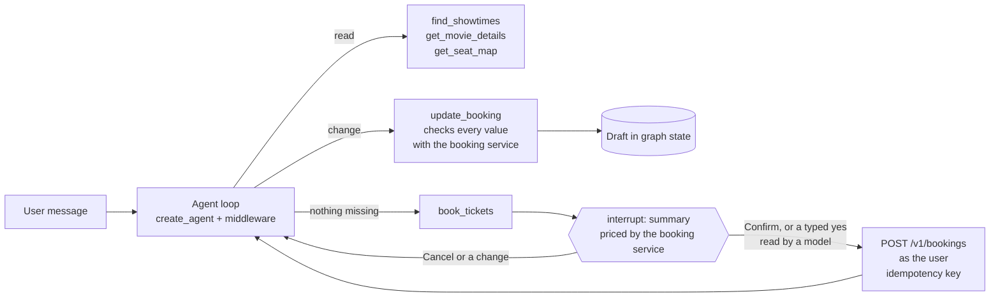

# Tiketa booking agent

A chat agent for a cinema. People write in Indonesian or English ("dune besok malem berdua, kursi tengah"), the
agent finds showtimes, reads the seat map and prepares the booking, and nothing is booked until the user confirms a
summary priced by the booking service.

It is an add-on. The cinema itself is [tiketa-app](https://github.com/rafi-seniang/tiketa-app): the booking API that
owns films, showtimes, seats and bookings, with the web app and an MCP server. This agent holds no cinema data. It
asks that service for everything and books through it as the person in the conversation. When the agent is off,
the web app shows the chat as Off and booking on the seat map works as before.

    browser ──► tiketa-app (booking API, Postgres, web app, MCP)      must be up
       │              ▲
       │              │ HTTP, with the user's own guest cookie or API key
       └──► this agent (LangGraph, its own Postgres for conversations)   can be off

v0.1.0 (tag) was the agent and the booking API in one service. v1 (2025) was a hand-written LangGraph loop on
Gemini with a Gradio UI.

## How a booking flows

The model understands the language. Code decides what is true, and the booking service has the last word: which
seats exist and are free, what they cost, whether the showtime has started, and whose booking it is.

| Concern | How |
|---|---|
| Free conversation, change of mind, relative dates | One LangChain `create_agent` loop. A fixed system prompt (rules, films), and the time in WIB and the draft as a last message on every call |
| Cost of long conversations | The fixed text comes first, so DeepSeek reads 80% of input tokens from its prompt cache |
| No invented ids, prices or seats | Tools check every value with the booking service. The draft only changes through `update_booking` |
| Booking only after a yes | `interrupt()` inside `book_tickets`, resumed by `POST .../confirmation` or a typed reply the reader model classifies |
| Words with the summary | A model that calls a tool often writes nothing beside the call. The sentence the user reads with the summary is a required argument of `book_tickets`, sent as a `message` event before the `confirmation` |
| The booking service says slow down | Its rate limit reaches the model as "try again in N seconds", not as a failed turn |
| The agent cannot do more than the user | Every call to the booking service carries the user's own credentials. The agent holds no key that can book |
| A seat sold once, a retry booking once | The booking service's unique constraint, and one idempotency key per tool call of a conversation |
| Who is calling | The booking service says. The agent keeps no API keys and signs no sessions |
| The booking service is down | Requests get 503 and a turn ends with an `error` event. The agent never answers from memory |
| Loops and outages | 10 model calls per turn at most, retries for failed and dropped calls, an `error` event otherwise |
| Long conversations | `SummarizationMiddleware` past 8,000 tokens. The draft is state, so it survives the summary |
| Restarts, several workers | Conversations are LangGraph checkpoints in Postgres. Redis holds the rate limit (60 requests a minute per caller) and a one-turn-at-a-time lock |
| Cost | 400,000 model tokens a day per caller and 3,000,000 for everyone together, counted in Redis. Over either, a turn gets 429 with `Retry-After` |
| Each message checked first | `GATEKEEPER_URL`: Gatekeeper judges every visitor message against the scope it keeps as `tiketa` (`GATEKEEPER_SCOPE_NAME`). A prompt injection or an off-topic request (code, recipes, poems) gets a fixed refusal in about 0.2 s and no model call. When Gatekeeper is down the message is not read, and the chat says so |
| A gateway in front of the model | `LLM_GATEWAY_URL` sends model calls through an OpenAI-compatible gateway such as Gatekeeper. Replies then arrive whole and thinking is off. Configured, not yet run live |
| Seeing what happened | JSON logs with a request id, and every model call, tool call and middleware step traced to a self-hosted Phoenix |

Decisions: [docs/adr/0001-architecture.md](docs/adr/0001-architecture.md) (the agent loop and its rules) and
[docs/adr/0002-an-add-on-to-the-booking-service.md](docs/adr/0002-an-add-on-to-the-booking-service.md) (the split).

## Measured

Thirteen scripted conversations (25 turns, Indonesian and English) against the running service and the booking
service, with real DeepSeek calls. Each turn is checked in code (the events it must and must not produce, the
bookings it ends with) and by `deepseek-v4-pro` as judge. The transcripts, with every tool call, are then graded with
[DeepEval](https://deepeval.com): per-turn conditions, tool use, role adherence and a G-Eval for the reply language.
Details, every run and what each found: [evals/README.md](evals/README.md).

| 15 November 2026, after the split | Code checks | Judge | Median turn | Slowest |
|---|---|---|---|---|
| First run | 25/25 | 24/25 | 2.5 s | 6.2 s |
| Last run, after three fixes | 25/25 | 25/25 | 2.2 s | 5.1 s |

The live runs found three things no unit test had: a rate limit at the booking service failed a whole turn, after
Cancel the agent once said seats were "still set aside", and the agent wrote no sentence with any of ten summaries.
All three are fixed. On the last run's transcript DeepEval passes 12 of 13 conversations on every check and 38 of
38 conditions (tool use 10 of 10, reply language 13 of 13, role adherence 12 of 13). The one failure is a refusal of
an off-topic request that took two sentences where the prompt asks for one. Earlier gradings passed 8 to 10 of 13,
and much of that movement came from how the transcript was shown to the judge, which the evaluation notes record.

On 8 November (v0.1.0, 17 turns) thinking was the difference on seats described in words: "three seats in the back
row by the aisle" came out right 3 of 3 times with it and 1 of 3 without.

## Run

Needs Python 3.12, Docker, `DEEPSEEK_API_KEY` in `../../secrets/secrets.env`, and tiketa-app running on port 8070
with this week's showtimes published.

    python -m venv .venv && .venv/Scripts/pip install -e ".[dev]"     # .venv/bin on Linux and macOS
    cp .env.example .env
    docker compose up -d                  # Postgres :5433, Redis :6383, Phoenix :6006, on 127.0.0.1 only
    alembic upgrade head                  # the schema. The service refuses to start on an older one
    python main.py                        # http://127.0.0.1:8060/docs

On a Postgres volume from before the split, run `make database` once before `alembic upgrade head`. It adds the
agent's own database and leaves the old one, with its bookings, as it is.

Without Docker, set `DATABASE_URL=sqlite+aiosqlite:///./agent.db` and empty `REDIS_URL` and
`PHOENIX_COLLECTOR_ENDPOINT`. On Windows, use `127.0.0.1` rather than `localhost` in the URLs (`localhost` tries IPv6
first and stalls), and run uvicorn without reload as `uvicorn main:app --port 8060 --loop asyncio:SelectorEventLoop`,
because psycopg's async mode needs a selector event loop.

Switch to Gemini with `LLM_MODEL=gemini/gemini-3.8-flash` (reads `GEMINI_API_KEY`). It is configured, not yet run live.

    make check        # ruff, mypy strict, 45 tests with a scripted model and an in-memory booking service
    make scenarios    # plays the conversations above, about 150k agent tokens, most of them read from the cache
    make evals        # grades the newest transcript with DeepEval (make evals-install once)

## API

| Method and path | What |
|---|---|
| `POST /v1/sessions` | Start a conversation, returns `session_id` |
| `POST /v1/sessions/{id}/messages` | Send a message. The reply streams as server-sent events |
| `POST /v1/sessions/{id}/confirmation` | `{"approved": true}` books the waiting summary, `false` cancels it. Streams like a message |
| `GET /v1/sessions/{id}` | The conversation: turns, draft, waiting summary, bookings |
| `GET /v1/usage` | The caller's chat tokens today against the daily budget |
| `GET /health`, `GET /meta` | Liveness (the web app polls it to show the chat On or Off) and what the service is |

Events, one JSON object per `data:` line: `token` (a piece of the reply), `tool` (the agent calls a tool), `confirmation`
(the summary to show with Confirm and Cancel), `booking` (the booking just made), `message` (the whole reply, the one to
keep), `error`, `end` (model calls and tokens of the turn). `/v1` takes the `X-API-Key` header or the guest session
cookie the booking service set, and asks that service who it is.

## Layout

    main.py                     entry point: uvicorn on the app from app/core/application.py
    app/settings.py             every environment value, typed (pydantic-settings)
    app/core/                   app factory, lifespan (the agent and every client built once at startup), database,
                                checkpointer, Redis, locks, token budget, tracing, errors, logging, dependencies
    app/middleware/             request id and access log, CORS, who is calling, the Redis rate limit
    app/routes/                 chat (SSE) and health
    app/controllers/            thin handlers between routes and services
    app/services/               business processes: the booking agent's graph, one chat turn around it
    app/generative/             every prompt in prompts.py, and the reader of a typed yes or no
    app/engines/llm.py          the chat model through LiteLLM (DeepSeek or Gemini), directly or through a gateway
    app/tools/                  the agent's tools, each checked with the booking service
    app/repositories/           the booking service's HTTP client, and who owns each conversation
    app/models/                 SQLAlchemy tables (conversation owners)
    app/schemas/                Pydantic models for the API, the agent's state and the booking service's answers
    app/utils/                  pure helpers: the cinema clock, the seat map as text
    scripts/                    run_scenarios.py
    evals/                      scenarios, transcripts, the DeepEval grading, what they found
    migrations/                 Alembic: 0001 and 0002 from the all-in-one service, 0003 the cinema tables leave
    tests/                      the real graph with a scripted model, the HTTP client, the API, the migrations
