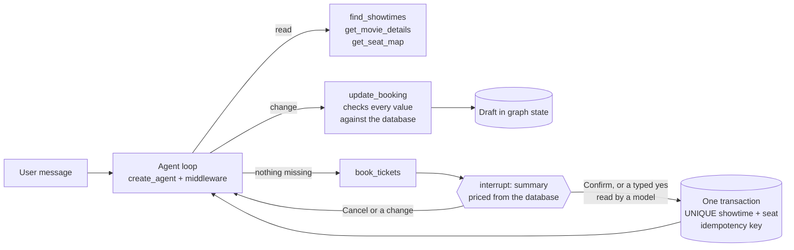

# Tiketa

A cinema booking assistant. People chat in Indonesian or English ("dune besok malem berdua, kursi tengah"), the agent
finds showtimes, reads the seat map and prepares the booking, and nothing is booked until the user confirms a summary
the server built from the database.

The second version of a 2025 portfolio project. v1 was a hand-written LangGraph loop on Gemini with a Gradio UI and
the conversation in a Python dict. v2 keeps the idea (one agent loop, separate read and write tools) and moves every
rule that must hold into code: typed booking state, a confirmation that pauses the graph, database constraints, durable
conversations and measured behaviour.

## How a booking flows

The model understands the language. Code decides what is true: which seats exist and are free, what they cost, whether
the showtime has started, whose conversation it is, and whether the user said yes to this exact booking.

| Concern | How |
|---|---|
| Free conversation, change of mind, relative dates | One LangChain `create_agent` loop. A fixed system prompt (rules, films), and the time in WIB and the draft as a last message on every call |
| Cost of long conversations | The fixed text comes first, so DeepSeek reads 80% of input tokens from its prompt cache |
| No invented ids, prices or seats | Tools validate against Postgres. The draft only changes through `update_booking` |
| Booking only after a yes | `interrupt()` inside `book_tickets`, resumed by `POST .../confirmation` or a typed reply the reader model classifies |
| A seat sold once | `UNIQUE (showtime_id, seat_id)`, all seats in one transaction, the tool call id as idempotency key |
| Other people's data | Conversation id and time come from the server (runtime context). Conversations belong to an API key |
| Keys in the browser | None: browsers get a signed HttpOnly guest session cookie from `POST /auth/guest`. Threat model in [SECURITY.md](SECURITY.md) |
| Loops and outages | 10 model calls per turn at most, retries for failed and dropped calls, an `error` event otherwise |
| Long conversations | `SummarizationMiddleware` past 8,000 tokens. The draft is state, so it survives the summary |
| Restarts, several workers | Conversations are LangGraph checkpoints in Postgres. Redis holds the rate limit (60 requests a minute per API key, `RATE_LIMIT_PER_MINUTE`) and a one-turn-at-a-time lock |
| Cost | 400,000 model tokens a day per caller and 3,000,000 for everyone together (`DAILY_TOKENS_PER_CALLER`, `DAILY_TOKENS_TOTAL`), counted in Redis. Over either, a turn gets 429 with `Retry-After`. The booking form spends none |
| Schema changes | Alembic migrations in `migrations/`. The service checks the revision at startup and never changes its own schema |
| Logs | JSON lines with a request id on every request, next to the traces |
| Seeing what happened | Every model call, tool call and middleware step traced to a self-hosted Phoenix |

Decisions and the options set aside (DeepSeek Harness, the kit's plain-loop template, HumanInTheLoopMiddleware) are in
[docs/adr/0001-architecture.md](docs/adr/0001-architecture.md).

## Measured

Scripted conversations against the running service with real DeepSeek calls, checked in code (events, bookings in
the database) and by `deepseek-v4-pro` as judge. Details and what each run found: [evals/README.md](evals/README.md).
The table compares thinking on the first ten conversations (17 turns). With the prompt cache layout, all thirteen
(25 turns) pass in code and with the judge.

| Thinking | Code checks | Judge | Median turn |
|---|---|---|---|
| off | 17/17 | 16/17 | 2.0 s |
| `low` (default) | 17/17 | 17/17 | 2.6 s |

Thinking was the difference on seats described in words: "three seats in the back row by the aisle" came out right 3
of 3 times with it and 1 of 3 without.

## Run

Needs Python 3.12, Docker, and `DEEPSEEK_API_KEY` in `../../secrets/secrets.env`.

    python -m venv .venv && .venv/Scripts/pip install -e ".[dev]"     # .venv/bin on Linux and macOS
    cp .env.example .env
    docker compose up -d                  # Postgres :5433, Redis :6383, Phoenix :6006, on 127.0.0.1 only
    alembic upgrade head                  # the schema. The service refuses to start on an older one
    PYTHONPATH=. python scripts/seed.py   # 21 films, a week of showtimes. Run again any day to extend it
    python main.py                        # http://127.0.0.1:8060/docs

Without Docker, set `DATABASE_URL=sqlite+aiosqlite:///./tiketa.db` and empty `REDIS_URL` and
`PHOENIX_COLLECTOR_ENDPOINT`. On Windows, use `127.0.0.1` rather than `localhost` in the URLs (`localhost` tries IPv6
first and stalls), and run uvicorn without reload as `uvicorn main:app --port 8060 --loop asyncio:SelectorEventLoop`,
because psycopg's async mode needs a selector event loop.

Switch to Gemini with `LLM_MODEL=gemini/gemini-3.8-flash` (reads `GEMINI_API_KEY`). It is configured, not yet run live.

    make check        # ruff, mypy strict, 33 tests with a scripted model: no key, no services
    make scenarios    # the evaluation above, about 85k agent tokens

## API

| Method and path | What |
|---|---|
| `POST /v1/sessions` | Start a conversation, returns `session_id` |
| `POST /v1/sessions/{id}/messages` | Send a message. The reply streams as server-sent events |
| `POST /v1/sessions/{id}/confirmation` | `{"approved": true}` books the waiting summary, `false` cancels it. Streams like a message |
| `GET /v1/sessions/{id}` | The conversation: turns, draft, waiting summary, bookings |
| `GET /v1/movies`, `GET /v1/showtimes?day=`, `GET /v1/showtimes/{id}/seats` | The catalog, for a UI next to the chat |
| `POST /v1/bookings` | Book from a form: `showtime_id`, `seats`, `customer_name`, and an `Idempotency-Key` header. No model is called |
| `GET /v1/bookings` | The caller's latest bookings from the chat and the form, newest first, each with its `channel` |
| `GET /v1/usage` | The caller's chat tokens today against the daily budget |
| `POST /auth/guest` | Sets a guest session cookie, for browsers, which never get an API key |
| `GET /health`, `GET /meta` | The Lab backend contract |

Events, one JSON object per `data:` line: `token` (a piece of the reply), `tool` (the agent calls a tool), `confirmation`
(the summary to show with Confirm and Cancel), `booking` (the booking just made), `message` (the whole reply, the one to
keep), `error`, `end` (model calls and tokens of the turn). `/v1` needs `X-API-Key` or a guest session cookie when `API_KEYS` is set.

## Layout

    main.py                     entry point: uvicorn on the app from app/core/application.py
    app/settings.py             every environment value, typed (pydantic-settings)
    app/core/                   app factory, lifespan (the agent and every client built once at startup), database,
                                checkpointer, Redis, locks, token budget, tracing, errors, logging, dependencies
    app/middleware/             request id and access log, CORS, API keys, the Redis rate limit
    app/routes/                 one APIRouter per area: chat (SSE), catalog, bookings, health
    app/controllers/            thin handlers between routes and services
    app/services/               business processes: the booking agent's graph, one chat turn around it
    app/generative/             every prompt in prompts.py, and the reader of a typed yes or no
    app/engines/llm.py          the chat model through LiteLLM (DeepSeek or Gemini)
    app/tools/                  the agent's tools, each checked against the database
    app/repositories/           every query: cinema store, conversation owners, seed data
    app/models/                 SQLAlchemy tables
    app/schemas/                Pydantic models for the API and the agent's state
    app/utils/                  pure helpers: the cinema clock, the seat layout
    scripts/                    seed.py, run_scenarios.py
    evals/                      scenarios, results, what they found
    migrations/                 Alembic: 0001 the first schema, 0002 booking owner and channel
    tests/                      the real graph with a scripted model, the store, the API, the migrations
